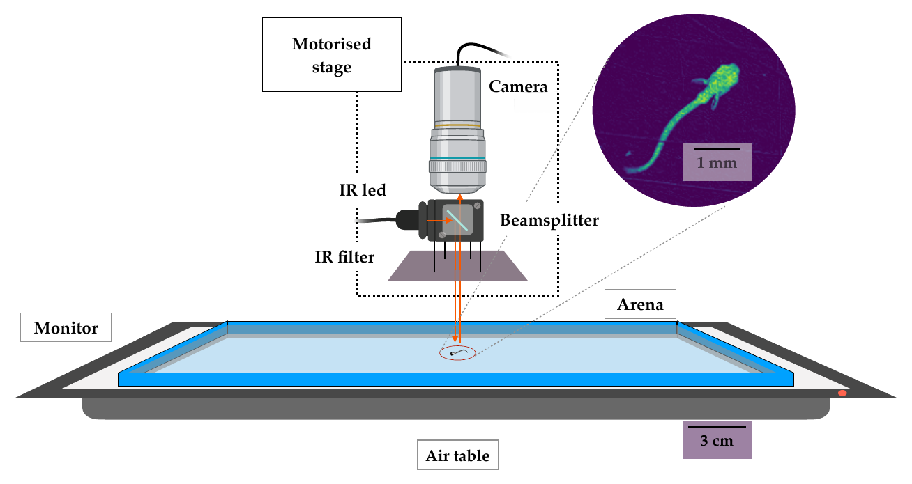
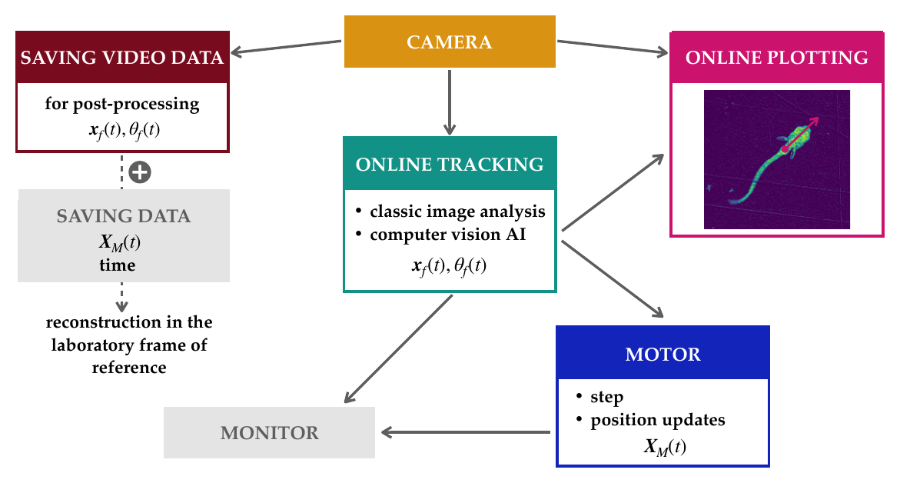

# fish-realtime-tracking

**Closed-loop, real-time tracking system for freely swimming larval fish, with a custom YOLOv8 detector and a SLEAP-based posture pipeline.**

[](https://doi.org/10.5281/zenodo.17650136)
[](https://doi.org/10.1126/sciadv.aec6922)

[](https://theses.hal.science/tel-05569582)
[](https://github.com/MonicaCoraggioso/fish-realtime-tracking/actions/workflows/tests.yml)

I designed and built this software to run the behavioural experiments of
[*A sensorimotor instability drives a locomotor transition during fish development*](https://doi.org/10.1126/sciadv.aec6922).
It follows a single *Danionella* larva (a translucent fish, a few mm long) as it swims freely across a large arena. A camera running at 250 fps sits on a motorised CNC gantry that keeps the fish in view, and visual stimuli are presented in closed loop.

The analysis of the resulting data is in the repository
**[locomotor-transition-development](https://github.com/MonicaCoraggioso/locomotor-transition-development)**. The full technical description of the set-up is in Chapter 2 of my [PhD thesis](https://theses.hal.science/tel-05569582).

<p align="center">
  
</p>
<p align="center"><sub>The camera and IR illumination ride on a motorised stage above the arena; a monitor under the tank displays the visual background. Inset: a tracked larva (scale bar 1 mm). From the thesis, Fig. 2.1.</sub></p>

---

## Pipeline

```
 ┌────────────────────────┐   ┌────────────────────────┐   ┌────────────────────────┐   ┌────────────────────────┐
 │ 1_yolo_detector/       │   │ 2_acquisition/         │   │ 3_pose_estimation/     │   │ 4_dataset_building/    │
 │ labelled frames →      │   │ 250 Hz camera capture  │   │ SLEAP keypoints +      │   │ quality filters,       │
 │ custom YOLOv8 detector │──▶│ real-time tracking     │──▶│ spline fit + image     │──▶│ spline regularisation, │
 │ (128×128 input, GPU)   │   │ gantry follows fish    │   │ registration → lab     │   │ merged INFO/KINE/POSE  │
 │                        │   │ closed-loop stimuli    │   │ frame trajectories     │   │ HDF5 for analysis      │
 └────────────────────────┘   └────────────────────────┘   └────────────────────────┘   └────────────────────────┘
        before experiments           during experiment             after experiment            input to analysis
```

| Module | What it does | Key tech |
|---|---|---|
| [`0_hardware/`](0_hardware/) | Set-up schematic and Shapeoko (GRBL) notes. | |
| [`1_yolo_detector/`](1_yolo_detector/) | Building the annotated dataset, training YOLOv8 for robust detection (fish near walls, dust, varied postures and sizes), inference demo. | Ultralytics YOLOv8, Roboflow |
| [`2_acquisition/`](2_acquisition/) | Real-time loop: frame grab → background subtraction → detection → head direction → motor command → stimulus update. Multi-threaded capture, tracking and motor control. | OpenCV, PyTorch/Ultralytics, PySerial (G-code), PsychoPy, FLIR Spinnaker |
| [`3_pose_estimation/`](3_pose_estimation/) | Offline posture estimation from recorded videos: SLEAP keypoints, midline spline, sub-pixel head registration, trajectory in the lab frame. | SLEAP (U-Net), scikit-image, Numba |
| [`4_dataset_building/`](4_dataset_building/) | Turns per-run outputs into the analysis-ready `INFO`, `KINE` and `POSE` tables used in the paper. | pandas, h5py, SciPy |

## Highlights

- **Real-time, multi-threaded**: camera at 250 Hz, online tracking at 50 Hz and motor control at 18 Hz run in parallel threads.
- **Hybrid detection**: fast classical CV (thresholding, ellipse fit) combined with a **custom-trained YOLOv8** detector that stays reliable where classical tracking fails (edges, dust, occlusions).
- **Smooth closed-loop control**: a spring–dashpot following law moves the camera gantry without jerks or noise that could disturb the fish.
- **Learned posture**: a SLEAP single-instance U-Net trained on 702 hand-labelled frames gives body keypoints, which are refined with spline fitting and phase-correlation registration.
- **Reproducible configs**: post-processing parameters live in a documented YAML file (`3_pose_estimation/config_default.yaml`).

## System design and performance

<p align="center">
  
</p>

The acquisition software runs **five threads in parallel** (Python `threading`), which share data through locks (`acquire()` / `release()`) to avoid race conditions:

| Thread | Role |
|---|---|
| Camera | Acquires frames and queues them for the other threads |
| Video saving | Writes frames to disk in 1-minute chunks, without blocking acquisition |
| Online tracking | Estimates the fish position and heading from each frame (classical image analysis + YOLOv8) |
| Motor control | Turns the fish offset into G-code commands that keep the fish centred in the field of view |
| Online plotting | Shows the live video and tracking result to the experimenter |

**Measured timing** (median time per cycle, over 86 experiments):

| Thread | Median cycle | Rate |
|---|---|---|
| Camera acquisition | 4 ms | ~250 Hz |
| Online tracking (YOLO-based) | 20 ms | ~50 Hz |
| Motor communication | 56 ms | ~18 Hz (limiting step of the loop) |

**Detection.** Classical background subtraction and thresholding take about 2 ms per frame but confuse dust with the fish and fail along the arena walls. A YOLOv8m model trained on my own labelled frames handles these cases; the two estimates are combined with a confidence weight, and when several objects are detected the one closest to the previous position is kept. See [`1_yolo_detector/`](1_yolo_detector/) for training, evaluation and the decision rules.

**Motor control.** The stage follows the fish like a damped spring: at each update it steps toward the fish with speed

$$V_{t+1} = -\alpha r + (1-\beta) V_t,$$

where $r$ is the fish's distance from the centre of the field of view. The gain $\alpha$ increases with fish age (faster fish), and the damping $\beta$ was calibrated with a projected moving dot so that corrections are fast but smooth. The motor command buffer is never left empty, which keeps motion continuous and quiet; a recovery mode searches along the last heading if the fish is lost, and software limits keep the stage inside the arena.

The control law is implemented in [`2_acquisition/utilities/motor_control.py`](2_acquisition/utilities/motor_control.py) and tested in `tests/test_motor_control.py` (closed-loop simulations: re-centring a still fish and keeping a swimming fish in view).

**Online tracking performance.** On average a fish is tracked continuously for about **15 minutes**, often more than 30 minutes for 14–28 dpf larvae (82 runs). See [`1_yolo_detector/README.md`](1_yolo_detector/README.md#evaluation) for details.

## Quick start

Each module has its own environment because they run on different machines (Windows acquisition PC with GPU vs. analysis workstation).

```bash
git clone https://github.com/MonicaCoraggioso/fish-realtime-tracking.git
cd fish-realtime-tracking

# Train or evaluate the detector (no special hardware needed)
pip install -r 1_yolo_detector/requirements.txt
cd 1_yolo_detector && jupyter notebook train_yolov8.ipynb
```

See each folder's README for details. The acquisition code needs the actual hardware (FLIR camera + Spinnaker SDK, Shapeoko CNC, projector).

## Tests

Unit tests cover the hardware-independent parts: the YOLO dataset and detection rules, the motor-following law (closed-loop simulations), pose and kinematics cleaning (`4_dataset_building/`), the post-processing configuration, and the calibration and watchdog helpers of the acquisition code. Checks on the trained YOLO weights run locally once the weights are downloaded. They run automatically on every push (GitHub Actions) and locally with:

```bash
pip install -r requirements-test.txt
pytest
```

## Data and model weights

Data are **not** stored in this repository. They are archived on Zenodo, published together with the paper: [10.5281/zenodo.17650136](https://doi.org/10.5281/zenodo.17650136).

| Item | Where |
|---|---|
| YOLOv8 training set (122 annotated 128×128 frames) | included: `1_yolo_detector/dataset/` |
| YOLOv8 weights `yolo8m_live_tracking.pt` (52 MB) | [GitHub Releases](https://github.com/MonicaCoraggioso/fish-realtime-tracking/releases) and Zenodo `Tracking_camera.zip` |
| SLEAP model weights `best_model.h5` | [GitHub Releases](https://github.com/MonicaCoraggioso/fish-realtime-tracking/releases) and Zenodo `Tracking_camera.zip` |
| Example raw recordings | Zenodo `Tracking_camera.zip` → `data/` |
| Processed datasets (`INFO`, `KINE`, `POSE`) | Zenodo `Data_processing.zip` |

## Citation

If you use this code, please cite the paper and the archive (see [`CITATION.cff`](CITATION.cff)). The set-up is described in detail in my PhD thesis:

> Coraggioso M., Demarchi L., Wong R., Dichio V., Chaumeton C., Panier T., Morvan-Dubois G., Goodhill G., Bormuth V., Debrégeas G. *A sensorimotor instability drives a locomotor transition during fish development.* *Science Advances* (2026). https://doi.org/10.1126/sciadv.aec6922
>
> Coraggioso M. *Multiscale locomotor dynamics in Danionella cerebrum.* PhD thesis, Sorbonne Université (2025). https://theses.hal.science/tel-05569582

## Author and credits

**Monica Coraggioso** ([ORCID](https://orcid.org/0009-0004-2091-3592)), Laboratoire Jean Perrin, Sorbonne Université. Data quality checks and dataset standardization (`4_dataset_building/`) by **Vito Dichio**.

## License

Code: [MIT](LICENSE). YOLO dataset: CC BY 4.0 (Roboflow export).
